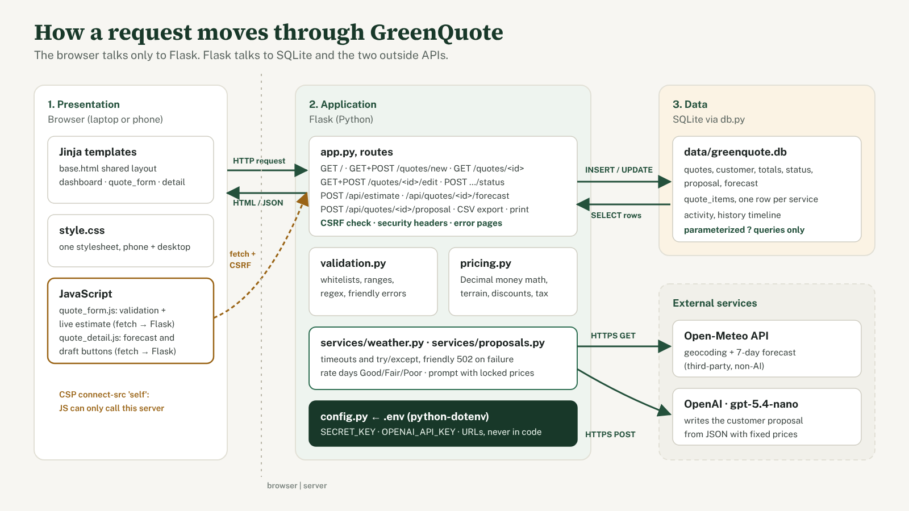

# GreenQuote

GreenQuote is a quoting and scheduling tool for small landscaping companies. Many owners still price jobs by hand at night and send quotes days late. GreenQuote lets an owner or crew lead build a priced, professional quote on a phone or laptop in a couple of minutes. It shows when the weather is good enough to start the job. It also writes the customer email for them.



## What it does

- Builds a priced quote as you type. You enter the services (mowing, cleanup, mulch, hedges, sod, irrigation), the terrain, the travel distance and how often the job repeats. `pricing.py` works out labor, material markup, a terrain multiplier, a recurring-customer discount, a tiered travel fee, sales tax on materials, a minimum job charge, a 30% deposit on jobs over $500 and the number of crew-days. Money math uses `Decimal`.
- Tracks every quote on one page: open and won totals, win rate, and a filterable list by status (Draft, Sent, Accepted, Declined).
- Checks the weather for the job site. It geocodes the city with the Open-Meteo API, pulls a 7-day forecast, rates each day Good, Fair or Poor for outdoor work and suggests the first good weekday as the start date. The result is saved with the quote.
- Drafts the customer email. It sends the saved quote to OpenAI's `gpt-5.4-nano` with the prices as fixed data, so every number in the email comes from the quote.
- Exports a CSV of one quote or all quotes, and has a print view that saves as a PDF.
- Logs each create, edit, status change, forecast and draft to an `activity` table, shown as the quote's history.

## Tech stack

| Tier | Files |
|---|---|
| Presentation | `templates/` (Jinja, shared `base.html`), `static/css/style.css`, `static/js/*.js` |
| Application | `app.py` (routes, CSRF, security headers, error handlers), `validation.py`, `pricing.py`, `services/weather.py`, `services/proposals.py`, `config.py` |
| Data | `db.py` → SQLite file at `data/greenquote.db` (tables `quotes`, `quote_items`, `activity`) |

## Install and run

Needs Python 3.10 or newer.

```bash
git clone https://github.com/connornkeane/greenquote.git
cd greenquote
python3 -m venv venv
source venv/bin/activate            # Windows: venv\Scripts\activate
pip install -r requirements.txt
cp .env.example .env                # then set SECRET_KEY and OPENAI_API_KEY in .env
flask --app app seed-demo           # optional: adds 3 sample quotes
flask --app app run --port 5050
```

Open http://127.0.0.1:5050. Port 5050 avoids macOS AirPlay Receiver, which takes port 5000. The database file and tables are created automatically the first time the app starts.

To try it on a phone on the same Wi-Fi, run `flask --app app run --host 0.0.0.0 --port 5050` and open `http://<your-computer's-IP>:5050`.

## Environment variables

Set these in `.env`. The real `.env` file is listed in `.gitignore` and never committed. `.env.example` shows the variable names with placeholder values.

| Variable | Required | Purpose |
|---|---|---|
| `SECRET_KEY` | Yes | Signs the session cookie and CSRF token. The app refuses to start without one (16+ characters). Generate with `python3 -c "import secrets; print(secrets.token_hex(32))"`. |
| `OPENAI_API_KEY` | For AI proposals | Key for the OpenAI API (the class key). Without it, everything else works and the proposal button shows a friendly message. |
| `OPENAI_MODEL` | No | Defaults to `gpt-5.4-nano`. |
| `BUSINESS_NAME` | No | Name printed on quotes and proposals. |
| `DATABASE_PATH` | No | Where the SQLite file lives. Leave it out to use `data/greenquote.db`. |
| `GEOCODE_URL`, `FORECAST_URL` | No | Open-Meteo endpoints. Open-Meteo needs no API key. |

## Security

- Secrets are loaded only from environment variables (`config.py`), never written in code.
- All calls to OpenAI and Open-Meteo happen in Flask. The Content-Security-Policy header sets `connect-src 'self'`, so the browser's JavaScript can only talk to this server.
- Every POST (forms and `fetch`) needs a CSRF token stored in the session.
- Inputs are checked twice. JavaScript checks them in the browser for quick feedback, and `validation.py` checks them again on the server using whitelists, number ranges and regular expressions.
- SQL uses parameterized `?` queries only. Jinja autoescaping blocks HTML/script injection.
- Errors from outside services are caught, logged to `logs/greenquote.log`, and shown as friendly messages. Users never see stack traces.
- Extra headers: `X-Frame-Options: DENY`, `X-Content-Type-Options: nosniff`, `Referrer-Policy`, HttpOnly + SameSite session cookie, and a 64 KB request size limit.

## Tests

```bash
python3 -m pytest -q
```

28 tests cover the pricing math, validation, the weather rating and recommendation logic (with the API mocked), the create/read/update flow, CSRF blocking, the JSON APIs, exports, and error handling when the AI or weather service fails.

## Project structure

```
greenquote/
├── app.py                 Flask app and routes
├── config.py              loads .env
├── db.py                  SQLite schema and queries
├── pricing.py             quote math
├── validation.py          server-side input validation
├── services/
│   ├── weather.py         Open-Meteo integration
│   └── proposals.py       OpenAI integration
├── templates/             Jinja pages (base.html layout)
├── static/css, static/js  styling and client-side scripts
├── tests/                 pytest suite
├── docs/architecture.png  n-tier diagram
├── video/                 project presentation video
├── CHECKLIST.md           completed requirements checklist
├── .env.example
└── requirements.txt
```
